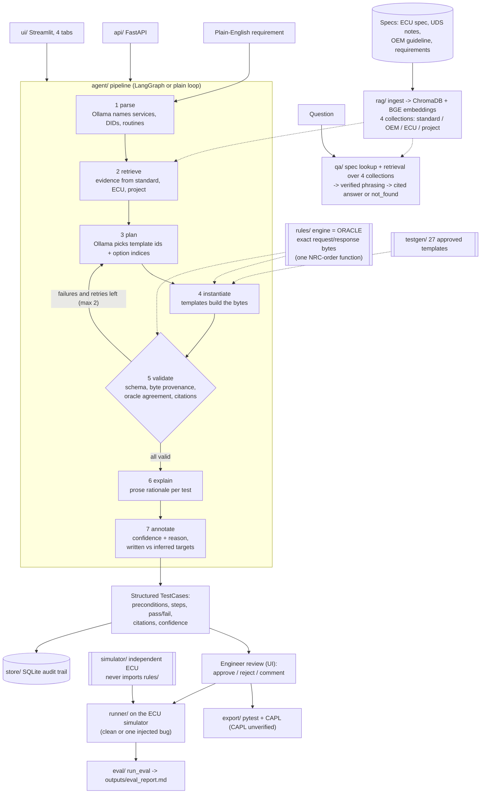

# Architecture

## Pipeline and components

Solid arrows are data flow, dotted arrows are "uses". The oracle and the simulator are two separate
programs written from the same prose contract ([behaviour_contract.md](behaviour_contract.md)); the
simulator never imports `rules/`.

## Retrieval

ChromaDB with `BAAI/bge-small-en-v1.5` embeddings (fastembed) is the only retriever. Knowledge is kept in
four separate collections, as the case study's risk control asks: **standard** (UDS reference notes in our own
words), **OEM** (a short synthetic guideline), **ECU** (chunks of the synthetic ECU spec) and **project**
(requirements and the behaviour contract). The store is `outputs/chroma/` (git-ignored); only new or changed
chunks are re-embedded. The four layers are four **physical** Chroma collections (`standard`, `oem`, `ecu`,
`project`, one per layer in `rag/chroma.py`, same chunking and embeddings for all); a search names the layers it
wants and only those collections are queried.

- Test generation does **not** search OEM: it reads standard, ECU and project only (`DECISIONS.md`
  E33-NO-OEM-IN-GEN). Reason: OEM policy text must not silently change protocol-derived expected bytes.
- Q&A searches **all four** layers, top-k per layer (`rag/layers.py`), because scores of separate collections
  are not comparable.
- Scores are cosine similarities. Every citation is checked against a real chunk (`rag/citations.py`).

## Cited Q&A

`qa/answer.py`: (1) deterministic lookup of DID / routine / NRC / service / security / timing facts in the parsed
spec; an unknown entity gives `not_found`; (2) otherwise retrieval, and a sentence must match enough of the
question's words to count as support, else `not_found`; (3) Ollama only rephrases, and its text is verified (every
looked-up value still present, no new numbers, every quote a substring of its chunk) or the template answer
is used; (4) confidence high / medium / low plus a reason (`agent/confidence.py`).

## Triangulation: does the oracle deserve trust?

1. **Simulator vs rules engine.** Random sequences of requests go to both; every response must match.
2. **Gold tests.** 60 hand-written tests with expected bytes derived from the contract, run on the clean simulator.
3. **udsoncan cross-check.** The `udsoncan` client talks to the simulator over a virtual CAN bus (session,
   seed/key, read, write, read-back).

All three share one author and one contract, so a shared misreading is invisible. Results: [RESULTS.md](RESULTS.md).

## "LLM does language, code does correctness"

The LLM never produces bytes that reach a final test. It reads the requirement and chooses template options;
code produces every byte, expected response and timing value.

| Guard | Where | Effect |
|---|---|---|
| LLM output schemas hold only identifiers, template ids, option indices and prose | [llm/base.py](../uds_assistant/llm/base.py) | There is nowhere for bytes to go |
| The plan is re-validated from a plain dict, dropping extra fields | [agent/nodes.py](../uds_assistant/agent/nodes.py) (`plan`) | Smuggled fields are discarded |
| The LLM chooses only from registered templates and enumerated options | [agent/options.py](../uds_assistant/agent/options.py), [testgen/templates.py](../uds_assistant/testgen/templates.py) | Closed menu |
| Bytes come only from template instantiation; expected responses from the rules engine | [rules/engine.py](../uds_assistant/rules/engine.py) | Deterministic, auditable |
| Byte provenance, oracle re-check and citation checks on every kept test | [agent/nodes.py](../uds_assistant/agent/nodes.py) (`check_test`, `validate`) | Failures are dropped and fed back to the planner |

This guarantees the bytes are consistent with the oracle. It does not guarantee the LLM picks the right
templates; the requirement-understanding and defect-detection numbers in [RESULTS.md](RESULTS.md) measure that.

## Runtime

Ollama is required. `llm/factory.py:get_llm()` raises `OllamaUnavailableError` when it is unreachable; the API maps
that to HTTP 503 and the UI shows "Start Ollama and pull qwen2.5:3b-instruct-q4_K_M". `Dockerfile` and
`docker-compose.yml` package the API and UI with an `ollama` service (written, not built here).
