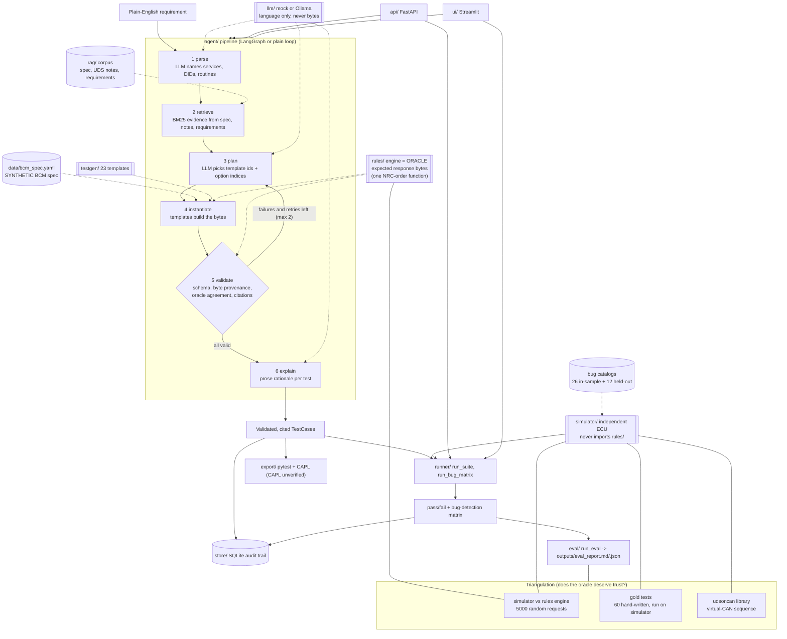

# Architecture

## Pipeline and components

How to read it: solid arrows are data flow; dotted arrows are "uses". The key idea is that the oracle and the simulator are two separate programs written from the same prose contract ([behaviour_contract.md](behaviour_contract.md)), and three independent checks compare them against each other, against hand-written expectations, and against a third-party library.

## Triangulation in plain words

No single check proves the oracle is right, so there are three:

1. **Simulator vs rules engine.** Random sequences of requests are fed to both; every response must match. Result: 5000/5000. Limit: same author, same contract, so a shared misunderstanding would not show.
2. **Gold tests.** 60 hand-written tests with expected bytes derived from the contract, run on the clean simulator: 60/60. Limit: same author again.
3. **udsoncan cross-check.** The well-known `udsoncan` Python client talks to the simulator over a virtual CAN bus (session, seed/key, read, write, read-back): PASS. Limit: it covers one happy path, not edge cases.

Separately, [SWS_DISAGREEMENTS.md](SWS_DISAGREEMENTS.md) lists nine places (D1 to D9) where the oracle's error-priority order differs from AUTOSAR's Dcm specification. They are documented and not fixed.

## "LLM does language, code does correctness"

The rule (stated in [AGENT.md](../AGENT.md)): **the LLM never produces bytes that reach a final test.** What the LLM does: read the requirement, choose which template options apply, write prose explanations. What code does: every byte, every expected response, every check.

How it is enforced:

| Guard | Where | Effect |
|---|---|---|
| LLM output schemas contain only identifiers, template ids, option indices and prose, no byte fields | [llm/base.py](../uds_assistant/llm/base.py) (`ParsedRequirement`, `PlannedTest`, `TestPlan`) | There is nowhere for bytes to go |
| The plan is re-validated from a plain dict, dropping extra fields a misbehaving backend might attach | [agent/nodes.py](../uds_assistant/agent/nodes.py) (`plan`) | Smuggled fields are discarded |
| The LLM chooses only from a fixed menu of registered templates and enumerated parameter options | [agent/options.py](../uds_assistant/agent/options.py), [testgen/templates.py](../uds_assistant/testgen/templates.py) (`TEMPLATES`, `applicable_params`) | Unknown template ids are rejected |
| Bytes come only from template instantiation; expected responses come from the rules engine | [testgen/templates.py](../uds_assistant/testgen/templates.py), [rules/engine.py](../uds_assistant/rules/engine.py) | Deterministic, auditable |
| "Byte provenance" check: a kept test's steps must equal a fresh template instantiation | [agent/nodes.py](../uds_assistant/agent/nodes.py) (`check_test`) | Any hand-edited bytes fail validation |
| Oracle re-check of every step, plus schema and citation checks | [agent/nodes.py](../uds_assistant/agent/nodes.py) (`check_test`, `validate`), [rag/citations.py](../uds_assistant/rag/citations.py) | Failures are dropped and fed back to the planner (max 2 retries) |
| The simulator must not import the oracle | [tests/simulator/test_independence.py](../tests/simulator/test_independence.py) | Keeps the two implementations independent |

What this does and does not buy: it guarantees the bytes are consistent with the oracle. It does not guarantee the LLM picks the right templates; that is what the requirement-understanding and held-out bug numbers in [RESULTS.md](RESULTS.md) measure, and with the mock LLM they are modest.
